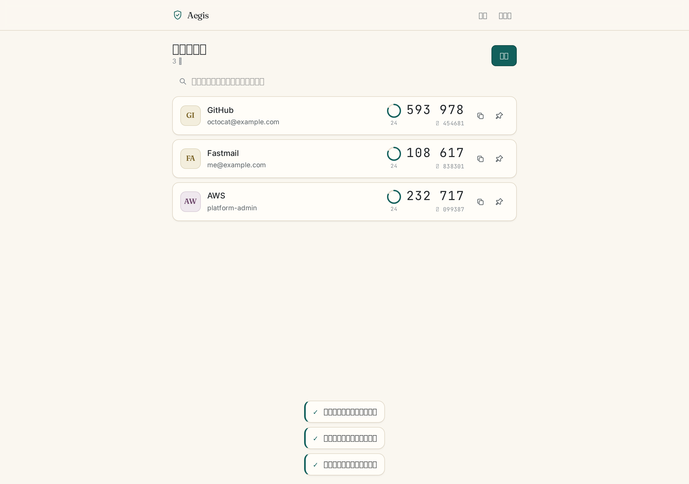
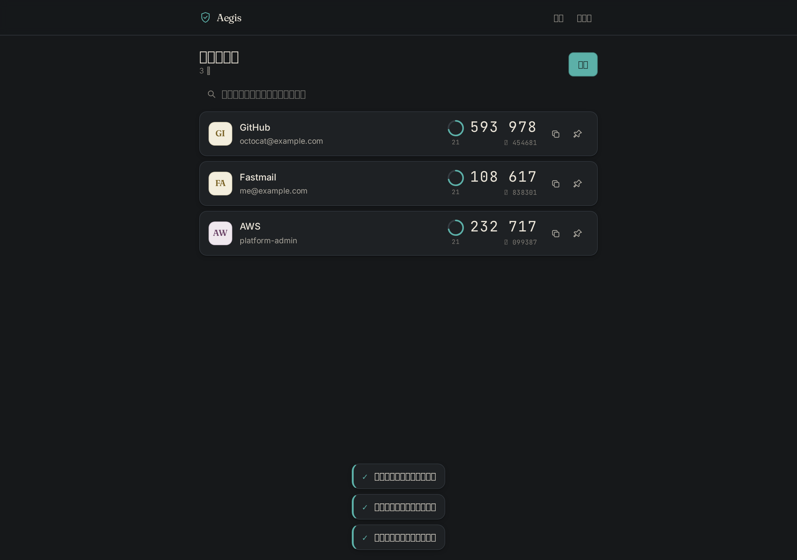
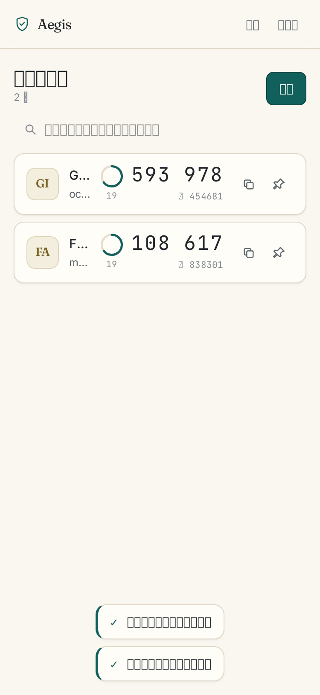

# Aegis 2FA

**ゼロ知識 E2EE 同期対応の Web 2FA Authenticator。** 秘密鍵はブラウザから出ません。
サーバーに置かれるのは AES-256-GCM の暗号文だけで、復号鍵（マスターパスワード由来の
KEK と DEK）はアンロック中のメモリにしか存在しません。



<table>
  <tr>
    <td></td>
    <td></td>
  </tr>
  <tr>
    <td align="center">ダークテーマ</td>
    <td align="center">375px 幅</td>
  </tr>
</table>

## 特徴

- **TOTP / HOTP**: RFC 6238 / RFC 4226 準拠。SHA-1 / SHA-256 / SHA-512、6 桁 / 8 桁、
  任意の period と counter、クロックスキュー補正（±2 ステップ）、次期コードの先出し表示
- **QR**: カメラ読み取り（`getUserMedia` + jsQR）、画像ファイルからの読み取り、QR 生成（PNG 保存可）
- **`otpauth://` URI** のパースと生成
- **Google Authenticator 一括移行**: `otpauth-migration://offline?data=...` の Protobuf を
  自前でデコード。未対応アルゴリズムは理由付きでスキップ、重複は検出して選択可能
- **ゼロ知識同期**: PBKDF2-HMAC-SHA-256 600,000 回 + AES-256-GCM（DEK ラップ + データ暗号）
- **ローカル完結モード**: 同期を使わなければネットワーク通信はゼロ
- **ロック / 自動ロック**: 既定 5 分、タブ非表示で即ロック（任意）、クリップボードは 30 秒で自動クリア
- **エクスポート**: 暗号化バックアップ（`.aegis`）、CSV（平文・警告付き）、移行 QR
- **PWA**: インストール可能、オフラインでコード生成。外部 CDN・外部フォント・解析タグなし
- **UI**: アイボリー×チャコール、セリフ見出し＋等幅コード、控えめなモーション。ライト/ダーク、375px 対応

## クイックスタート

```bash
pnpm install --frozen-lockfile
pnpm dev          # http://localhost:5173（Vite + API 同時起動）
```

本番ビルド:

```bash
pnpm build        # dist/（SPA）と dist-server/（Node）
pnpm start        # http://localhost:3000
```

### Docker

```bash
docker compose up --build -d
curl -fsS http://localhost:3000/api/health
```

マルチステージビルド、非 root 実行、`read_only` ルートFS、ヘルスチェック付きです。
詳細は [docs/DEPLOY.md](docs/DEPLOY.md)。

## 環境変数

| 変数 | 既定値 | 説明 |
| --- | --- | --- |
| `PORT` | `3000` | 待ち受けポート |
| `DATABASE_PATH` | `./data/aegis.db` | SQLite ファイル（親ディレクトリは自動作成） |
| `TRUST_PROXY` | `false` | リバースプロキシ配下で `true` |
| `AEGIS_HTTPS` | `false` | TLS 終端が前段にある場合 `true`（HSTS 付与） |
| `CORS_ORIGIN` | 未設定 | 通常は未設定。別オリジンから API を使う場合のみ |

秘密情報の環境変数はありません。サーバーは復号鍵を持たない設計です。

## セキュリティモデル（要約）

```
master password ──PBKDF2-SHA256(600k, salt)──► KEK ──AES-GCM unwrap──► DEK ──AES-GCM──► accounts
```

- サーバーが保存するのは `kdf`（salt, iterations）、`cipher`（iv, wrappedDek）、
  `data`（iv, ciphertext）、`revision`、`updatedAt`、`tokenHash` のみ
- 同期トークン本体は保存されません（`SHA-256(token)` のみ）。不一致は 404 で存在も秘匿
- AAD に revision を含めるため、暗号文と revision の不一致は復号時に検出されます。
  ただし正当な旧 envelope 全体（revision を含む）を再送された場合は AAD では検出できません
  （既存端末はサーバー revision との比較で古い応答を採用しませんが、初回接続時は比較基準がありません）
- CSP `default-src 'self'` / `connect-src 'self'` / `script-src 'self'`、`nosniff`、`DENY`、
  `no-referrer`、COOP/CORP、`no-store`（`/api/*`）、レート制限、zod による入力検証

保証しないこと（ブラウザ拡張、メモリダンプ、侵害された端末、パスワード忘却など）は
[docs/SECURITY.md](docs/SECURITY.md) に明記しています。

## 構成

```
shared/   純粋ロジック（base32 / hotp / totp / otpauth / migration / crypto / merge / sync）
server/   Hono + SQLite(Drizzle)。暗号文の保存と配信のみ
src/      React 19 + Vite + Tailwind 4 のクライアント
tests/    unit（Vitest）/ integration（Hono app.request）/ e2e（Playwright）
```

データフローと競合解決は [docs/ARCHITECTURE.md](docs/ARCHITECTURE.md)。

## 開発コマンド

```bash
pnpm lint         # ESLint
pnpm typecheck    # tsc --noEmit（client + server）
pnpm test         # Vitest（unit + integration）
pnpm build        # SPA + サーバー
pnpm test:e2e     # Playwright（要 pnpm build）
```

## テスト

| 層 | 内容 |
| --- | --- |
| unit | RFC 4226 / 6238 の公式テストベクタ全一致、Base32 境界、`otpauth` パース、移行 Protobuf、暗号の往復と改ざん検出、マージ規則 |
| integration | 実 SQLite + `app.request`。PUT/GET/meta/DELETE、楽観ロック 409、404 秘匿、バリデーション、413、レート制限 429、セキュリティヘッダ、**DB とペイロードに平文秘密鍵が無いこと**、ログに秘密が出ないこと |
| e2e | 作成 → 追加 → 時刻固定でコード一致、ロック/解錠、検索/ピン、バックアップ書き出しと復元、移行 URI 一括インポート、2 端末同期、375px レイアウト、ダークのコントラスト、セキュリティヘッダ |

## デプロイ

Docker Compose / Fly.io / Render / VPS + Caddy の手順は [docs/DEPLOY.md](docs/DEPLOY.md)。

## ライセンス

[MIT](LICENSE) © 2026 金子悠史 (yuushi-labs)
