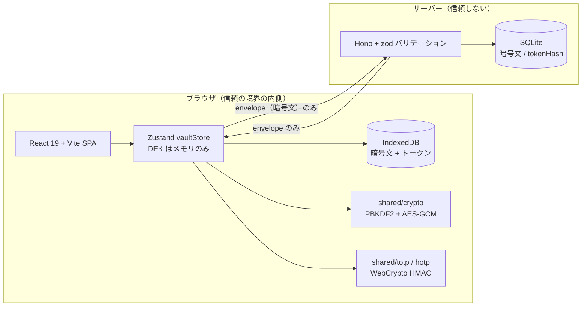
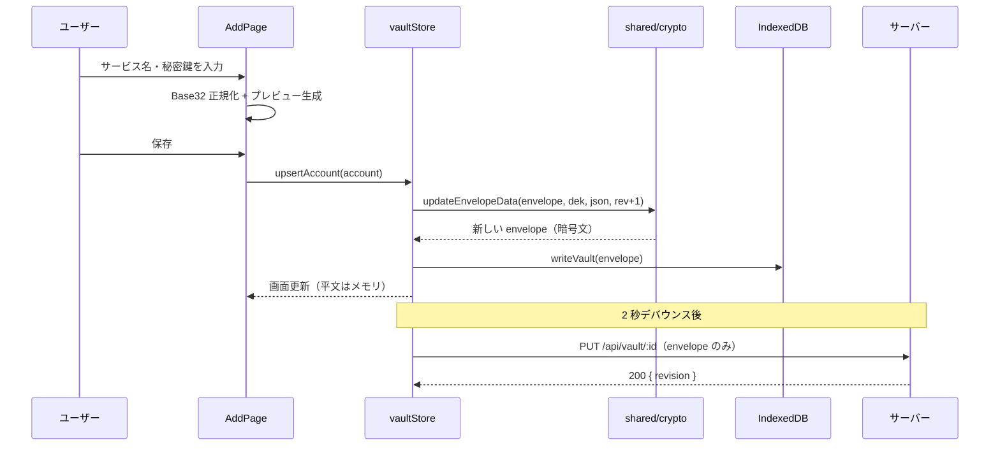
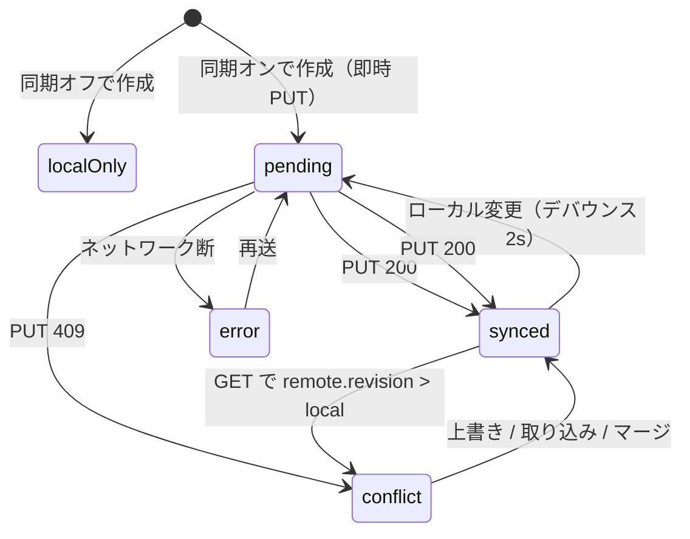
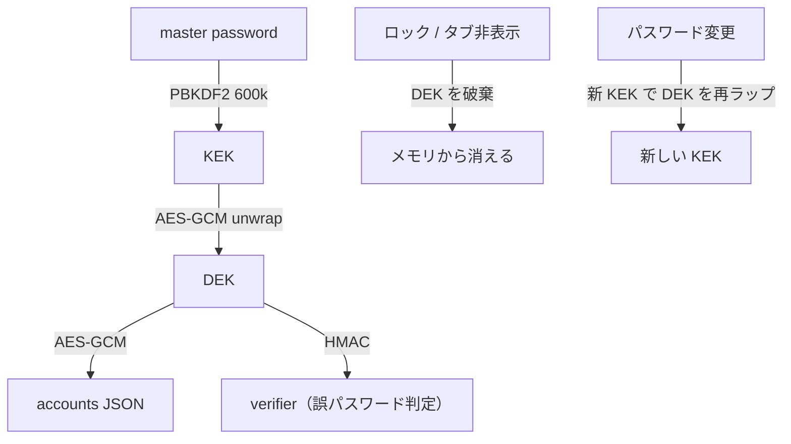

# アーキテクチャ

## 全体像

サーバーを通過するのは `VaultEnvelope`（salt / iv / wrappedDek / ciphertext）だけです。
`shared/` のコードはブラウザと Node の両方で動きますが、復号処理が走るのは
マスターパスワードを受け取ったブラウザだけです。

## モジュールの責務

| パス | 責務 |
| --- | --- |
| `shared/types.ts` | ドメイン型、既定値、上限（`PBKDF2_ITERATIONS` など） |
| `shared/base32.ts` | RFC 4648 Base32 のデコード / 正規化 / 妥当性判定 |
| `shared/hotp.ts` | RFC 4226 HOTP。WebCrypto の HMAC を動的切り詰め |
| `shared/totp.ts` | RFC 6238 TOTP。ステップ計算、残秒、スキュークランプ |
| `shared/otpauth.ts` | `otpauth://` URI のパースと生成 |
| `shared/migration.ts` | Google Authenticator の Protobuf（`otpauth-migration://`）デコード |
| `shared/crypto.ts` | 封筒の作成・解錠・再ラップ。DEK / KEK の管理 |
| `shared/merge.ts` | 同期競合のマージ（`updatedAt` 優先、削除は tombstone なしの単純和集合） |
| `shared/sync.ts` | 同期トークン生成、`vaultId = SHA-256(token)` 先頭 16B、tokenHash |
| `server/app.ts` | Hono アプリ組み立て、静的配信、エラーハンドリング |
| `server/routes/vault.ts` | PUT / GET / meta / DELETE。楽観ロック（revision） |
| `server/middleware/*` | セキュリティヘッダ、レート制限、ボディ上限、リクエストログ |
| `server/db/*` | better-sqlite3 + Drizzle。マイグレーションは起動時適用 |
| `src/lib/vaultStore.ts` | アンロック状態、暗号化保存、同期スケジューラ、競合解決 |
| `src/lib/storage.ts` | IndexedDB（`idb`）。ボルト・トークン・設定の 3 ストア |
| `src/pages/*` | 画面。`Setup` / `Lock` / `Accounts` / `Add` / `Detail` / `Settings` / `Sync` |

## データフロー: アカウント追加

## 同期の競合解決

- サーバーは **楽観ロック** を行います。`body.revision` が現在の revision と一致しない場合は
  `409` と `currentRevision` を返します。
- クライアントは黙って上書きせず、`conflict` 状態にして 3 択を提示します。
  - **上書き**: ローカルの envelope を新しい revision で PUT
  - **取り込み**: サーバーの envelope をローカルに保存（要アンロック）
  - **マージ**: 同じ DEK で両方を復号し、`updatedAt` の新しい方を採用
- マージはアカウント単位の和集合です。削除は「削除済み」フラグを持たないため、
  両端末で削除と編集が交差した場合は編集が勝ちます（制約として許容）。

## 鍵のライフサイクル

ロックすると `dek` を `null` にし、平文の `accounts` も空にします。暗号文（envelope）は
IndexedDB に残りますが、復号鍵は失われます。

## テスト戦略

| 層 | 対象 | 方針 |
| --- | --- | --- |
| unit | `shared/*` | RFC の公式テストベクタ、境界値、壊れた入力 |
| integration | `server/app.ts` | `app.request()` で実 HTTP を経由。実 SQLite（一時ファイル） |
| e2e | 画面 | 本番ビルドに対して Playwright。時刻を固定して TOTP 一致を検証 |

integration テストでは、サーバーが受け取ったペイロードと SQLite ファイルのバイト列に
平文の秘密鍵・パスワードが含まれないことを直接検査しています（ゼロ知識の証明）。
